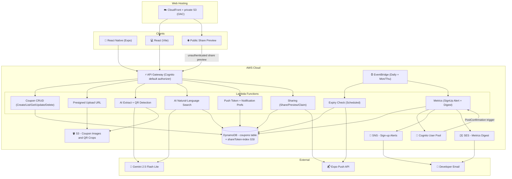
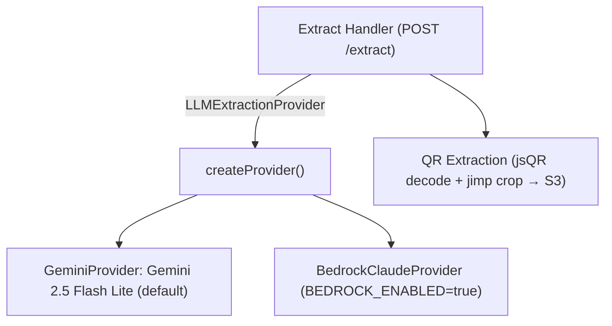
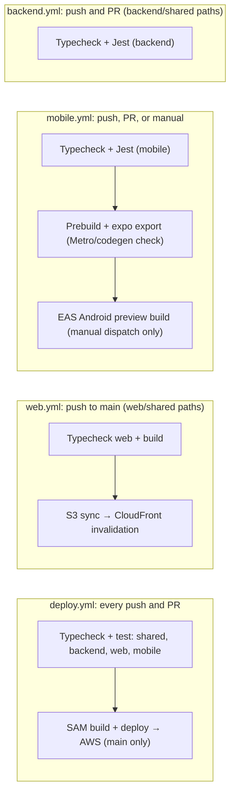

# Vaulty 🎫

> A full-stack, AI-powered coupon and voucher manager.

[](https://dxs2rcgjhblur.cloudfront.net/)
[](https://github.com/Manuel-Castellon/Vaulty/releases/latest)


Vaulty is a modern, cross-platform application that helps users digitize, track, and utilize their coupons and vouchers. Built with a serverless architecture, it leverages AI to automatically extract key details from photos of physical receipts, streamlining the storage and retrieval process.

## 📸 See it in Action

Vaulty seamlessly captures and manages receipts. Using integrated artificial intelligence, you simply snap a photo—Vaulty automatically populates the store, discount amount, expiration dates, and QR code logic directly into the cross-platform application.

https://github.com/user-attachments/assets/cf6eb0b8-d958-49b1-befa-c3a98394de4a

*If the inline video does not play, [click here to view the demo](https://github.com/Manuel-Castellon/Vaulty/blob/main/docs/demo/Vaulty_Demo.mp4).*

## 📲 Try it Out

Vaulty is fully functional across both web and mobile. Use the links below to test the AI extraction and cross-platform sync.

| Platform | Link | Status |
| :--- | :--- | :--- |
| **🌐 Web App** | [Try Vaulty in the Browser](https://dxs2rcgjhblur.cloudfront.net/) | Live Deployment |
| **📱 Android** | [Download Latest APK](https://github.com/Manuel-Castellon/Vaulty/releases/latest) | v1.0.0 (MVP) |

### 🛠️ Android Installation Notes
1. **Download**: Grab the latest `.apk` from the [Releases](https://github.com/Manuel-Castellon/Vaulty/releases) page.
2. **Permissions**: You may need to "Allow installation from unknown sources" in your Android settings to install the build.
3. **Login**: Use the same credentials across both platforms to see real-time sync in action.


## 🏗️ Technical Architecture

Vaulty handles complex state across web and mobile via a unified, serverless backend.

### System Overview


The backend stack (`packages/backend/template.yaml`) and the web hosting stack (`packages/web/infra/hosting.yaml`) are two separate CloudFormation stacks. The web bundle is served from a private S3 bucket fronted by CloudFront via Origin Access Control; the SPA talks to API Gateway directly.

### API Surface

Every route is authenticated by the API Gateway Cognito default authorizer except the public share preview, which overrides it with `Authorizer: NONE`. Handlers read the caller from `event.requestContext.authorizer.claims.sub`.

| Method | Path | Lambda | Purpose |
| :--- | :--- | :--- | :--- |
| `GET` | `/coupons` | `list` | List the caller's items |
| `POST` | `/coupons` | `create` | Create an item |
| `GET` | `/coupons/{id}` | `get` | Fetch one item |
| `PUT` | `/coupons/{id}` | `update` | Update an item (incl. usage tracking) |
| `DELETE` | `/coupons/{id}` | `delete` | Delete an item |
| `POST` | `/extract` | `extract` | AI extraction from image, PDF, or text |
| `POST` | `/search` | `search` | Natural-language search over the caller's items |
| `GET` | `/upload-url` | `presigned-url` | Presigned S3 PUT URL for a coupon image |
| `POST` | `/push-token` | `register-token` | Register an Expo push token |
| `GET` `PUT` | `/notifications/preferences` | `preferences` | Read/write expiry-alert preferences |
| `POST` `DELETE` | `/coupons/{id}/share` | `share` | Mint or revoke a share token |
| `GET` | `/shared/{shareToken}` | `shared-preview` | **Public**: preview a shared item |
| `POST` | `/coupons/claim/{shareToken}` | `claim` | Claim a shared item as an independent copy |

Three functions are not fronted by API Gateway: `expiry-check` (EventBridge, `rate(1 day)`), `metrics-digest` (EventBridge, `cron(0 8 ? * MON,THU *)`), and `signup-notification` (Cognito PostConfirmation trigger).

### Single-Table Layout

One DynamoDB table (`coupons-{stage}`) holds everything, keyed by `userId` (HASH) + `id` (RANGE). Coupons use a UUID as the sort key; per-user settings reuse the same partition with reserved sort keys (`PUSH_TOKEN` and `NOTIFICATION_PREFS`), so a user's data is one partition and needs no second table. The scheduled expiry scan filters those reserved ids out explicitly. TTL is enabled on a `ttl` attribute at the table level, but no handler currently writes it.

### LLM Provider Abstraction
The extraction pipeline is built on a provider-agnostic interface (`LLMExtractionProvider`), enabling switching between AI models without modifying core handler logic. `createProvider()` picks the implementation from environment configuration at invocation time.



For image uploads, the LLM call and QR detection run concurrently via `Promise.allSettled`. If jsQR decodes a value the model missed, it fills in the `code` field; if the provider hits its quota but QR detection succeeded, the request still returns the QR result with a `quota_exhausted` warning instead of failing outright.

The `/search` handler calls Gemini directly rather than through this interface; it is a separate, simpler path with no file or QR handling.

### CI/CD Pipeline
Four GitHub Actions workflows cover the monorepo. Typechecks and tests gate every deploy; the two deploy paths (backend and web) fire only on `main`, and the Android build is manual.



All jobs run on Node 24, matching the `nodejs24.x` Lambda runtime.

## 🚀 Key Engineering Decisions

- **LLM Provider Abstraction:** A provider-agnostic interface that enables hot-swappable AI backends (Gemini, Bedrock) without altering handler logic or QR orchestration.
- **Structured Observability:** The extraction pipeline emits JSON-structured CloudWatch events through a shared `log()` helper, tracking outcome, provider, input type, and duration for queryable insights. Other handlers use plain `console` logging.
- **Multi-Format Extraction:** A unified pipeline accepting images (JPEG, PNG, WebP), PDFs, and raw text across both platforms, with source-language and script preservation enforced by a validation-and-retry pass on the model output.
- **Graceful Degradation:** Quota management that falls back to QR-only extraction and manual-entry paths when the provider rate-limits, with a per-user, per-input cooldown so repeat submissions short-circuit instead of burning quota.
- **Full-Stack Type Safety:** A unified NPM Workspaces monorepo where the `@coupon/shared` library enforces strict TypeScript contracts between the AI backend and all clients.
- **Serverless Scale & IaC:** Infrastructure-as-Code (AWS SAM / CloudFormation) ensuring a reproducible, horizontally scalable stack with zero idle cost.
- **Event-Driven Lifecycle:** A daily EventBridge schedule scans DynamoDB for upcoming expirations and sends proactive alerts via the Expo Push API, honouring each user's stored notification preferences (on/off, days-before-expiry).
- **Coupon Sharing:** A sparse DynamoDB GSI on `shareToken` enables unauthenticated public preview lookups without full-table scans. Claimed coupons are independent copies—no cross-user references—keeping the data model simple at Phase 1 scale.
- **Developer Metrics:** Zero-cost operational visibility via Cognito PostConfirmation → SNS (real-time sign-up alerts) and a twice-weekly EventBridge → SES HTML digest covering user and coupon growth. No CloudWatch custom metrics ($0.30/metric/month).

## ⚖️ Tradeoffs & Limitations

- **Cold Start Latency:** Using AWS Lambda for the backend ensures zero idle cost but introduces occasional sub-second cold starts. This was accepted in favor of cost-efficiency for a B2C application with variable traffic.
- **DynamoDB Access Patterns:** The schema is optimized for the dominant path, list-by-user, via a `Query` on the `userId` partition key. Share-link lookups go through the sparse `shareToken-index` GSI. The two scheduled jobs (expiry check, metrics digest) use full-table `Scan`s, which is acceptable at current scale but is the first thing that would need reworking as the table grows.
- **Cost Control:** 
    - **LLM as Primary Driver:** AI extraction is the dominant cost. The architecture includes a "Fallback Mode" and quota-limiting logic to protect against bot-driven cost spikes.
    - **Serverless Efficiency:** Lambda and DynamoDB (On-Demand) were chosen specifically to maintain a "Free Tier" friendly profile while handling bursty mobile usage.
- **Gemini Quota Constraints:** Using the Flash Lite tier provides high speed and low cost, but includes rate limits. The system handles these gracefully by falling back to QR-only or manual entry paths.
- **Throughput Assumptions:** The current architecture prioritizes per-request responsiveness over massive batch processing, fitting the "snap-and-save" mobile user flow.

## 📊 Observability & Insights

Vaulty has two tiers of observability: structured logs for the AI extraction path, and a lightweight developer metrics pipeline for business-level tracking.

### Structured CloudWatch Logs

The extraction handler emits JSON-structured events (`extract.started`, `extract.completed`, `extract.failed`, `extract.quota_cooldown_short_circuit`) queryable via CloudWatch Insights:

**Example: Extraction Success Rate (Last 24h)**
```sql
fields @timestamp, event, outcome, provider, durationMs
| filter event = "extract.completed" or event = "extract.failed"
| stats count() as total, count_distinct(outcome) by outcome
| sort total desc
```

### Developer Metrics Pipeline

Two lightweight mechanisms surface business-level data without CloudWatch custom metric costs:

- **Sign-up Alerts:** Cognito PostConfirmation → SNS → email. Fires within seconds of each verified registration.
- **Twice-weekly Digest:** EventBridge (Mon + Thu 8AM UTC) → Lambda → SES HTML email. Reports total users, new users, total coupons, and breakdowns by category, status, and item type—all queried live from DynamoDB and Cognito at send time.

## 🛠️ Local Setup 

This is an NPM Workspaces monorepo (`packages/backend`, `packages/mobile`, `packages/web`, `shared`). Node 20+ is the declared minimum; CI and the Lambda runtime both use Node 24.

```bash
# 1. Install workspace dependencies
npm install --legacy-peer-deps

# 2. Run the platform of your choice:
npm run web           # Start the Vite React web server
npm run mobile        # Start the Expo React Native server

# Backend development (requires AWS SAM CLI and packages/backend/env.json)
npm run backend:dev   # Start SAM local API
npm run backend:deploy

# 3. Per-workspace checks
npm run typecheck --workspace=packages/backend   # or packages/web | packages/mobile | shared
npm run test --workspace=packages/backend        # Jest; web uses Vitest, shared uses node:test
```

## 📚 Project Deep Dive

Check out the [CLAUDE.md](./CLAUDE.md) file for a granular breakdown of the MVP status, data models, infrastructure, and CI/CD operations.
